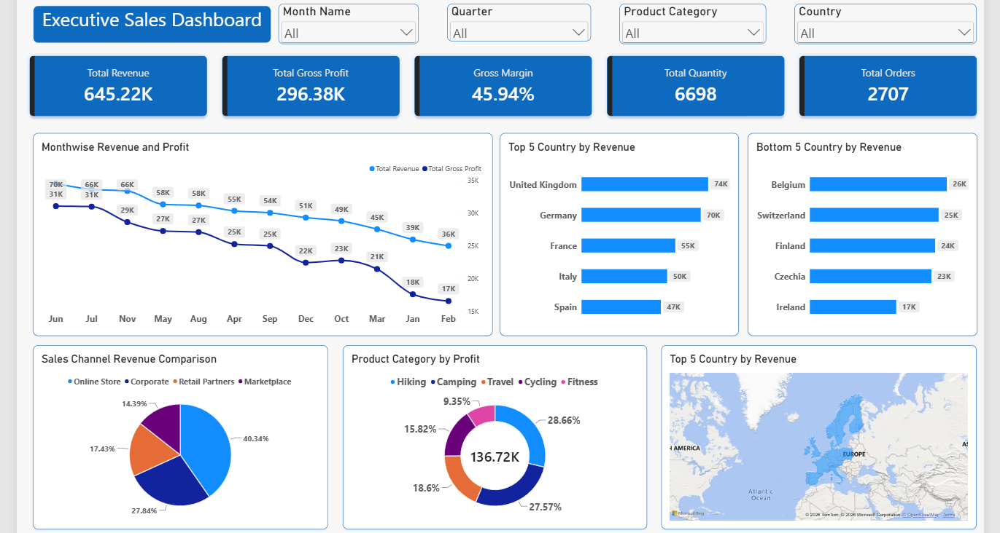

#  Executive Sales Dashboard - Power BI

An end-to-end business intelligence project that transforms raw sales data into an interactive, insight-driven Executive Sales Dashboard using Power BI.

---

##  Project Overview
This dashboard was built to track, analyze, and visualize global sales performance, profitability, and regional trends. It empowers stakeholders to drill down into metrics by month, quarter, product category, and country.

##  Key Performance Indicators (KPIs)
* **Total Revenue:** $645.22K
* **Total Gross Profit:** $296.38K
* **Gross Margin:** 45.94%
* **Total Quantity Sold:** 6,698
* **Total Orders:** 2,707

##  Key Skills & Features Demonstrated
* **Data Modeling:** Built a robust relational schema connecting a custom Date Calendar table to the sales transaction data.
* **DAX Measures:** Developed advanced DAX formulas for calculating KPIs, profit margins, and dynamic aggregations.
* **Interactive Slicers:** Added global filters for Month, Quarter, Product Category, and Country.
* **Data Visualization:**
  * **Trend Analysis:** Month-wise Revenue and Profit line charts.
  * **Geospatial Analysis:** Map visual highlighting revenue distribution across countries.
  * **Categorical Breakdowns:** Donut charts for Sales Channel and Product Category Profit distributions.
  * **Ranking:** Top 5 and Bottom 5 countries by revenue bar charts.

##  Dashboard Preview

##  Repository Structure
- `Executive_Sales_Dashboard.pbix` - The complete Power BI project file.
- `Dataset/` - Raw datasets used for the analysis.
- `Screenshots/` - Visual assets of the dashboard.
